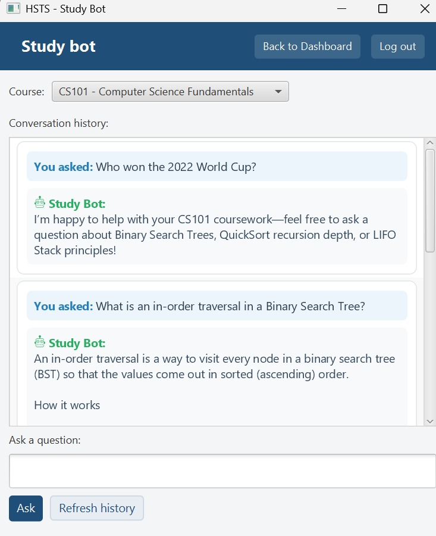
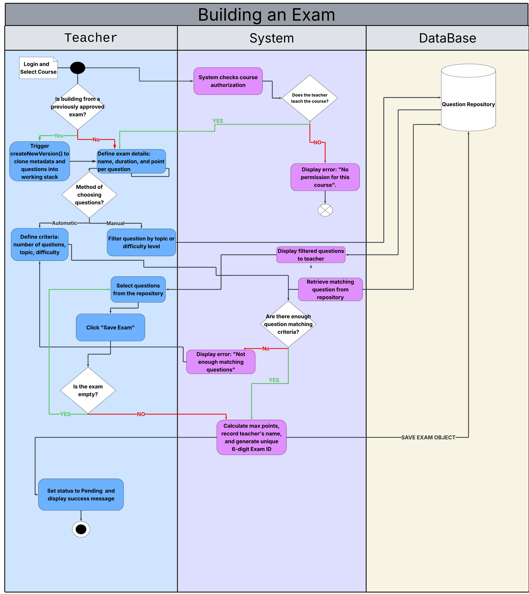
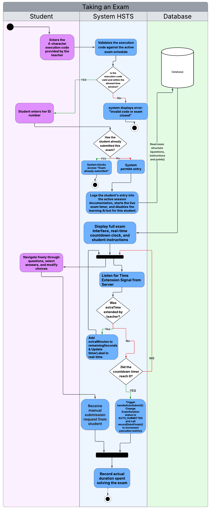
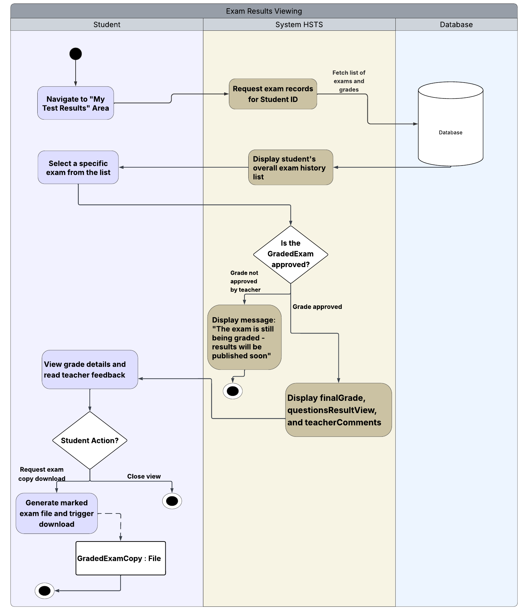

# HSTS – High School Test System

A desktop client–server system for running school exams end to end: teachers build exams from a question bank, coordinators approve them, students take them with a live timer, and results flow back to teachers and the principal. Includes an AI study bot that answers course questions for students.

Built as the semester project for Software Engineering (203.3140), University of Haifa, by a team of three.



---

## Features by role

| Role | What they can do |
|---|---|
| **Student** | Take exams with a live countdown timer · view graded results · ask the AI study bot course questions and see history |
| **Teacher** | Manage the question bank (create / edit / search) · build exams manually or automatically · grade submissions (student vs. correct answers, color-coded) · extend time during a running exam · configure the study bot and view anonymized usage stats |
| **Coordinator** | Approve exams · set open/close dates · issue execution codes students need to start an exam |
| **Principal** | School-wide statistics (mean, median, deciles) · compare results across exams · read-only question bank |

Screens update live: when one user changes something (an approval, a time extension), other connected users see it without refreshing.

---

## Tech stack

- **Java 17**, built with **Maven**
- **JavaFX 17** (FXML + CSS) for the desktop client
- **OCSF** client–server framework over TCP sockets
- **MySQL 8** via JDBC, behind a repository layer
- **Groq LLM API** for the study bot (OpenAI-compatible chat completions)

## Architecture

```
JavaFX client → OCSF socket → ServerRequestRouter → controllers → repository layer → MySQL
                                                   ↘ BotApiClient → Groq API
Server EventBus → ConnectionRegistry → pushes live updates to the right clients
```

- `com.hsts.client` – GUI windows, controllers, networking
- `com.hsts.shared` – entities and DTOs shared by client and server (the protocol contract)
- `com.hsts.server` – socket server, request routing, live-update event bus
- `server.controllers` – business logic, validation, request authorization
- `server.db` – database access and repositories

---

## Design diagrams

<details>
<summary><b>Activity diagram – Building an exam</b> (manual or automatic question selection → save as pending)</summary>



</details>

<details>
<summary><b>Activity diagram – Taking an exam</b> (execution code → live timer → time extension → auto-submit)</summary>



</details>

<details>
<summary><b>Activity diagram – Viewing exam results</b></summary>



</details>

📄 [Sequence diagram – Execute exam (PDF)](docs/diagrams/sequence-execute-exam.pdf): the full message flow across the GUI, client controllers, server controllers and entities.

---

## My contribution (Hadeel Abbas)

| Area | What I built |
|---|---|
| **Client GUI** | The entire desktop client: login, role-based dashboard, question bank, exam builder (manual + automatic), approval, exam taking with live countdown timer, grading view (color-coded), results, time extension, shared navigation and visual style |
| **Testing** | A mock server plus an end-to-end smoke test covering the full exam lifecycle, so the client could be built and verified before the real server existed |
| **Server** | Command handlers for starting exams, available/pending exams, grading queue, results, time extension and bot usage stats |
| **AI study bot** | API integration (Gemini, then Groq), and enforcement that students can only ask about courses they're enrolled in |
| **Exam scheduling** | Multiple executions per exam, coordinator-set open/close dates, execution-code validation |
| **Statistics & live updates** | Principal statistics (mean / median / deciles); live auto-refresh across all screens |
| **Security** | Moved the API key and DB credentials into an external, git-ignored config file |
| **Design** | Worked on the UML activity and sequence diagrams above |

**Teammates:**
- **Hazar Zoabi**: database schema and seed data, server controllers and DB tests, study-bot teacher configuration and chat UI, packaged runnable JARs
- **Gharam Nimer**: client–server connection and disconnect handling, Phase 1–2 fixes, principal reports, read-only question bank

---

## Running locally

**Requirements:** JDK 17 with JavaFX (e.g. Liberica Full JDK 17), MySQL 8, Maven.

1. **Create the database.** Run `init.sql` in MySQL. It creates the schema and seeds test data.
2. **Add your config.** Copy `config.properties.template` to `config.properties` in the project root and fill in your MySQL password and a Groq API key (free at console.groq.com). This file is git-ignored. Never commit it.
3. **Start the server:** run `com.hsts.server.MainServerApp`.
4. **Start the client:** run `com.hsts.client.MainApp` (or `mvn javafx:run`).

**Test accounts** (all with password `123456`): `student1`, `teacher1`, `coord1`, `principal1`.

Without a Groq key the app still runs; the bot just returns a fallback answer.

---

## Testing

`SmokeTest` drives the full exam lifecycle end to end: login → build → approve → take → grade → results, plus the bot and time-extension flows. The server side has its own database integration tests.

## What I'd improve next

- Hash passwords (e.g. bcrypt). The seed data currently stores them in plain text.
- Add a GitHub Actions workflow to build and run the tests on every push.
- Package the client as a single installer instead of requiring a JavaFX-enabled JDK.
